# Phase 2: deterministische Load-Management-Engine

**Phase 2 calculates control actions but does not execute them against real go-e devices.**

Die Engine ist eine Domänenkomponente. Ihre Imports beschränken sich auf Konfigurationstypen, normalisierte Domänenmodelle und eigene Policy-/Scheduler-Module. HTTP, Dateisystem, HCU, Logging und echte Uhrzeit sind keine Engine-Abhängigkeiten. Der vorhandene HTTP-Layer bleibt ausschließlich `GET /api/status`.

## Eingaben, Entscheidungen und Bestätigung

```ts
const manager = new LoadManager(validatedConfig);
const decision = manager.evaluate({
  timestampMs,
  measurementId,
  controller, // Result<ControllerStatus>
  chargers,   // { chargerId, status: Result<ChargerStatus> }[]
});
// decision: state, status, action (null oder eine Aktion), actionId
```

`timestampMs` ist die explizite Zeit der Messung. `measurementId` kennzeichnet die vollständige Momentaufnahme eindeutig innerhalb der Session. Derselbe Messwert darf nicht beliebig viele Regelaktionen auslösen. Es gibt keine verdeckte `Date.now()`-Abhängigkeit oder Hintergrundintervalle.

Eine ausgegebene Aktion ist zunächst ein Plan. Eine Domänenquittierung `acknowledgeAction(actionId, 'applied')` und eine passende neue Statusbeobachtung sichern den nächsten Schritt ab. Die reine Simulation übernimmt diese Bestätigung nach Änderung ihres eigenen In-Memory-Snapshots. In Phase 2 existiert kein Adapter, der eine solche Aktion an echte Geräte sendet.

Ausstehende Quittierungen erscheinen in `pendingAction`. Nach der letzten Freigabe hält `awaitingObservationChargerIds` die noch benötigten Rückmeldungen fest. Weder eine verspätete `RESUME`-Wirkung noch ein noch nicht beobachtetes Löschen/Wiederherstellen von `tcl` erlauben einen weiteren Freigabeschritt oder einen vorzeitigen Abschluss der Regelphase. Falsche oder bereits quittierte Aktions-IDs ändern den Engine-State nicht.

Der Vertrag enthält ausschließlich folgende Aktionen:

```ts
type ControlAction =
  | { type: 'SET_TEMPORARY_CURRENT_LIMIT'; chargerId: string; amps: number }
  | { type: 'PAUSE'; chargerId: string }
  | { type: 'RESUME'; chargerId: string }
  | { type: 'CLEAR_TEMPORARY_CURRENT_LIMIT'; chargerId: string };
```

Pro Entscheidung gibt es höchstens eine Chargeraktion. Auch bei Override werden mehrere Charger oder Limit-/Pause-Kombinationen nacheinander behandelt.

## Grenzen und Zustandsmaschine

Alle Werte kommen aus der validierten Konfiguration:

```text
targetGridW        = gridLimitW - safetyReserveW
recoveryThresholdW = gridLimitW - 2 * safetyReserveW
triggerDurationMs  = triggerDurationSeconds * 1000
controlIntervalMs  = controlIntervalSeconds * 1000
```

Mit der Beispieldatei gilt: 19.000 W Triggergrenze, 18.500 W Regelziel, 18.000 W Recovery-Schwelle, 30 s Auslösezeit, 4 s Regelintervall, 1 A Regelschritt. Diese Beispiele sind keine Konstanten der Engine.

```mermaid
stateDiagram-v2
  NORMAL --> TRIGGER_PENDING: Grid > Grenze und regelbarer Charger lädt
  TRIGGER_PENDING --> NORMAL: Grid <= Grenze oder keiner lädt
  TRIGGER_PENDING --> LIMITING: kontinuierliche Auslösezeit erreicht
  LIMITING --> PAUSED: eigene Pause
  LIMITING --> RECOVERING: Grid <= Recovery-Schwelle
  PAUSED --> RECOVERING: Reserve und Mindestpausendauer erfüllt
  RECOVERING --> LIMITING: Grid > Ziel
  RECOVERING --> NORMAL: eigene Einschränkungen vollständig aufgehoben
  LIMITING --> LIMIT_UNACHIEVABLE: steuerbare Last ausgeschöpft
  PAUSED --> LIMIT_UNACHIEVABLE: steuerbare Last ausgeschöpft
  LIMIT_UNACHIEVABLE --> RECOVERING: ausreichend Reserve
  LIMITING --> OVERRIDE: explizites Override
  PAUSED --> OVERRIDE: explizites Override
  RECOVERING --> OVERRIDE: explizites Override
  OVERRIDE --> NORMAL: explizites Session-Ende nach Freigabe
```



`FAULT` ist von jeder Phase aus möglich, wenn die für eine sichere Entscheidung erforderlichen Daten fehlen oder widersprüchlich sind. Dabei bleiben bereits eigene Einschränkungen erhalten. Die Grafik zeigt die fachlichen Hauptübergänge; die Entscheidung bleibt zusätzlich von gültigen Messungen, Aktionsquittierung und Intervall abhängig.

Genau `gridImportW == gridLimitW` startet keinen Trigger. Die Überschreitung muss ohne Unterbrechung bestehen. In einer bestehenden Regelphase ist die Auslösezeit bereits erfüllt; neue Reduktionen warten nur auf Intervall, frische Messung und bestätigte vorherige Wirkung.

Für aktive Phasen gilt zentral:

| Netzbezug | Verhalten |
| --- | --- |
| größer als Ziel | nächsten Reduktions-/Pausenschritt suchen |
| größer als Recovery-Schwelle, höchstens Ziel | eigene Einschränkungen halten |
| höchstens Recovery-Schwelle | einen Recovery-Schritt versuchen |
| fehlt/ungültig | keine Freigabe; `FAULT` |

Ein gültiger negativer `gridPowerW` ergibt `gridImportW=0`; ein fehlender Wert bleibt unavailable. Die Engine interpretiert weder `null` noch einen Controllerfehler als 0 W.

## Priorität und Round Robin

Eine größere Prioritätszahl wird zuerst reduziert. Eine kleinere Prioritätszahl wird zuerst wieder freigegeben. Nur aktivierte und erreichbare Charger werden für eine neue automatische Reduktion berücksichtigt. Ob ein Charger lädt, entscheidet ausschließlich der bestehende `isActivelyCharging()`-Helper für den dokumentierten `car=2`-Zustand.

Der Scheduler hält pro Priorität einen Ring in Konfigurationsreihenfolge. Je Regelrichtung gibt es einen eigenen Cursor. Nach einer ausgewählten Aktion wird beim nächsten Ringmitglied weitergesucht; vorübergehend unberechtigte Mitglieder werden übersprungen, ohne die Ringreihenfolge oder den Cursor der anderen Richtung zu verändern. Damit ergibt sich bei Links/Rechts zum Beispiel `Links 13 A`, `Rechts 13 A`, `Links 12 A`, `Rechts 12 A`.

Beim Recovery wird zuerst die höchste erreichbare Priorität mit eigenen Einschränkungen ausgewählt. Wartet diese Gruppe vollständig auf eine Mindestpausendauer, bleibt die Engine stehen, statt niedrigere Prioritäten vorher freizugeben. Innerhalb derselben Priorität werden bereits berechtigte Mitglieder weiter bedient. Ohne erzeugte Aktion wird der Scheduler-Cursor nicht vorgerückt.

Innerhalb einer Prioritätsgruppe werden zunächst noch mögliche Stromreduktionsschritte bedient. Ein Charger am Mindeststrom wird dabei übersprungen. Wenn keine solche Reduktion mehr möglich ist, kann ein Charger am Minimum mit Pausenunterstützung pausiert werden. Eine schlechtere Prioritätsgruppe wird vor dem Wechsel zur besseren Gruppe ausgeschöpft: Links am Minimum wird vor einer Garage-Reduktion pausiert, sofern Links der einzige noch aktive Kandidat dieser Gruppe ist und die Pause unterstützt.

## Stromwerte, Besitz und Recovery

`amp` ist ausschließlich der Benutzer-Sollwert. Die Engine erzeugt keine Änderung dieses Wertes. Für Reduktionen werden der gültige effektive Strom `acu`, ein vorhandenes `tcl`, `amp`, gegebenenfalls `ama` und der Charger-Mindeststrom `mca` konservativ zusammengeführt. Fehlendes `acu` bei einem tatsächlich ladenden Charger erlaubt keinen aus `amp` geratenen Reduktionsschritt.

Vor der ersten eigenen Einschränkung hält die Engine das ursprüngliche temporäre Limit fest. Ein fremdes `tcl` wird dadurch keine eigene Einschränkung. Die Freigabe berücksichtigt weiterhin Benutzer-/Maximalstrom und das fremde ursprüngliche Limit. Ein fremdes Limit wird mit `SET_TEMPORARY_CURRENT_LIMIT` auf seinen gespeicherten Ausgangswert zurückgesetzt; `CLEAR_TEMPORARY_CURRENT_LIMIT` ist ausschließlich bei ursprünglich fehlendem Limit zulässig. Eigene geplante Aktionen und quittierte Einschränkungen bleiben nachvollziehbar im Engine-State.

Eine eigene Pause bleibt Bestandteil derselben Regelphase. Im Simulationsmodell entspricht sie dem vom Nutzer bestätigten Zustand `frc=1`, `car=4`, `alw=false`, `acu=null` bei weiterhin bestehendem Mindestlimit. `RESUME` stellt im Modell `frc=0`, `car=2` und das weiterhin bestehende temporäre Limit her. Dieser Ablauf ist eine ausdrückliche Simulation der beschriebenen Tests, keine zusätzliche allgemeine API-Semantik. Die gemeldete Mindestpausendauer in Millisekunden wird beim normalen Recovery berücksichtigt.

Fehlt am effektiven Mindeststrom ein explizites temporäres Mindestlimit, erzeugt die Engine zunächst `SET_TEMPORARY_CURRENT_LIMIT` auf `mca` und erst in einem späteren Zyklus `PAUSE`. Die Pausendauer wird aus der Beobachtung beim Pausieren übernommen und gilt auch für die Freigabe durch Override. Ein allein ladender Charger am Minimum ohne Pausenunterstützung startet keine neue Regelphase; werden solche Grenzen innerhalb einer bereits aktiven Regelphase erreicht, kann das Ziel als nicht erreichbar gemeldet werden.

Recovery bevorzugt Garage vor Links/Rechts, erhöht höchstens `ampStep` A pro Entscheidung (aktuell 1 A) und wartet danach wieder. Eine Pause wird zuerst aufgehoben; ein Stromerhöhungsschritt kommt frühestens in einem späteren Zyklus. Das Ende einer eigenen Begrenzung verlangt vollständig aufgehobene eigene Pausen/Limits und weiterhin zulässigen Grid-Wert. Die Engine schätzt nicht, welche reale Wattänderung ein Ampere oder ein Wiederanlauf bewirken wird.

## Override, Session-Lifecycle und Fehler

`applyManualOverride()` ist ein explizites Domänenereignis. Es setzt `OVERRIDE`, nimmt nur eigene Einschränkungen abstrakt zurück und verhindert neue Grid-Trigger für dieselbe Session. `endSession()` ist das vorbereitete explizite Session-End-Ereignis. Es darf erst nach einem gesondert abgesicherten echten Lifecycle-Signal durch eine spätere Integration aufgerufen werden.

**`car=4` allein ist kein Session-Ende.** Dieser Code wurde auch bei der erzwungenen Pause beobachtet. Phase 2 erfindet deshalb keine automatische reale Session-Erkennung. Eigene Pausen werden durch Aktionsbesitz erkannt, nicht durch eine umbenannte Car-State-Definition.

`FAULT` meldet unsichere Controller-/Grid-Daten, widersprüchliche Messungen oder fehlende essenzielle Chargerinformationen. Es erzeugt keine spekulative Aktion und entfernt eigene Einschränkungen nicht aufgrund eines unbekannten Grid-Wertes. Ein einzelner unerreichbarer Charger macht andere erreichbare Charger nicht automatisch ungültig. Die nächste erforderliche Entscheidung muss trotzdem mit den noch verfügbaren Daten sicher möglich sein.

`LIMIT_UNACHIEVABLE` zeigt, dass die verbleibende steuerbare Ladeleistung den zu hohen Netzbezug nicht weiter reduzieren kann. Der strukturierte Status enthält Grid, Ziel und die verfügbare steuerbare Last. Die Engine produziert keine fortlaufenden identischen Pause-Commands. Bei wieder ausreichender Reserve ist Recovery möglich.

## Simulation und Grenzen

`runSimulation(config, initialStatuses, samples)` ist eine reine In-Memory-Harness. Jeder Sample liefert expliziten Zeitstempel und vorzeichenbehafteten Grid-Wert oder `null`. Die Harness erstellt normalisierte Controllerergebnisse, ruft die Engine auf, kopiert die Momentaufnahme in einen SimulationStep und wendet ausschließlich die erzeugte Aktion auf ihre eigenen Charger-Snapshots an. Der nächste Sample sieht diese Änderung. Die Anfangsdaten werden nicht verändert.

`applySimulatedAction()` ist kein Netzwerkadapter. `SET_TEMPORARY_CURRENT_LIMIT` ändert im Modell `tcl` und den simulierten zugelassenen Strom; `PAUSE`/`RESUME` ändern ausschließlich In-Memory-Statusfelder; `CLEAR_TEMPORARY_CURRENT_LIMIT` löscht das simulierte Limit. Nur von der Engine erzeugte und ihr gehörende Freigabeaktionen werden in `runSimulation()` angewendet. Der pure Helper ist separat für Tests nutzbar.

Die CLI `npm run simulate` liest Parameter aus `config.example.json` und ersetzt Gerätehosts vor der Validierung durch `.sim`-Namen. `--config` kann alternative Policy-/Prioritätsdaten liefern. Die Statuswerte sind ausdrücklich technische Beispieldaten: Garage lädt mit 14 A, andere aktivierte Charger sind idle, Mindeststrom 6 A und Firmware 59.4 entsprechen dem beschriebenen Szenario. Diese Beispielwerte gehören zum Szenario und werden nicht von der Engine hardcodiert. Hosts werden nie aufgelöst, Statuswerte nie per HTTP geladen.

Der Standardablauf zeigt den real gemeldeten 22.839-W-Fall: bis 29,999 s keine Aktion, bei 30 s Garage 13 A, beim nächsten 4-s-Schritt Garage 12 A. Anschließend gibt es Halten, Recovery und ein unavailable-Sample. Die vom Benutzer vorgegebene Grid-Sequenz wird nicht aus Chargerströmen errechnet. `rawNrg` bleibt unverändert und ohne erfundene Indexbedeutung erhalten.

Offen für einen späteren gesonderten Integrationsauftrag sind reale Aktionsausführung und Bestätigung, fremde Eingriffe, echte Session-End-Erkennung, Mehrfach-Charger-Recoverytests, `nrg`-Interpretation, HCU-Kommunikation und Produktivverpackung. Keine dieser Integrationen gehört zu Phase 2.
